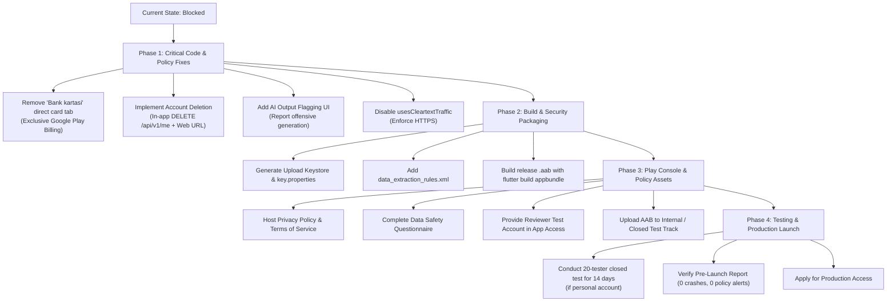

# Google Play Release Readiness and Android Compliance Audit
**Project:** The Go-getters (CogniDoc AI Document Analyzer & Chatbot)  
**Package Name / Application ID:** `com.aichat.app.mobile`  
**Auditor:** Google Play Release Readiness and Android Compliance Agent  
**Audit Date:** 2026-10-16  
**Compliance Baseline:** Google Play Developer Program Policies (2026 Edition), Android 15/16 Guidelines, Google Play Billing Library Specifications  
**Overall Release Readiness Status:** 🛑 **BLOCKED / NOT READY FOR PRODUCTION** (Critical Policy & Security Blockers Identified)

---

## 1. Executive Summary & Verdict

A thorough, read-only compliance and release readiness audit of the **The Go-getters** Android application and supporting Go backend has been executed.

While core architectural modules (such as Flutter Riverpod state management, RevenueCat Billing SDK integration with BillingClient 8.3.0, and server-side webhook processing with idempotent event logging) are functional, **the application currently cannot be published or approved on Google Play** due to several critical policy violations and build configuration deficiencies:

1. **Severe Payments Policy Violation (Google Play Billing Bypass):**  
   The application embeds a custom "Bank kartasi" (Direct Credit Card) payment sheet alongside Google Play Billing, including a "Sinov kartasi" (Test Card) shortcut and client-side simulated activation (`purchaseManual` / `POST /api/v1/billing/sync`). Google Play strictly requires that all digital subscriptions and digital features consumed in-app use **Google Play's billing system exclusively**.
2. **Account Deletion Policy Non-Compliance:**  
   Google Play mandates that any app supporting in-app account creation must offer **both in-app account deletion and an external web deletion request link**. In the current Flutter app, the deletion dialog displays a mock message directing users to contact customer support, and the backend exposes no `DELETE /api/v1/me` endpoint.
3. **AI-Generated Content (AIGC) Safeguards Missing:**  
   Under Google Play's Artificial Intelligence-Generated Content policy, apps generating text/multimodal outputs via generative models must provide an **in-app flagging/reporting mechanism for offensive or illegal outputs** and enforce a moderation workflow. Neither the mobile UI nor the backend currently contains an AI output flagging or reporting flow.
4. **Android Release Security & Build Misconfigurations:**  
   - `android:usesCleartextTraffic="true"` is hardcoded in `AndroidManifest.xml`.
   - Release build signing is hardcoded to debug keystore (`signingConfig = signingConfigs.getByName("debug")`).
   - Automated native debug symbol extraction is suppressed in Gradle (`tasks.whenTaskAdded`).
   - Backup rules and data extraction policies (`data_extraction_rules.xml`) are undeclared.
   - Privacy Policy and Terms of Service URLs are missing from the repository, store listing configurations, and settings screens.

---

## 2. Git & Repository Integrity Verification

- **Repository Work Tree Status:**  
  The workspace root `c:\Users\user\Desktop\document-workspace` is an unversioned working directory (no `.git` directory found; `git status` exited with fatal error).
- **Integrity Guarantee:**  
  No existing application source code or configurations were modified or overwritten during this read-only audit. All findings are derived directly from static analysis of existing source files, build scripts, Gradle configurations, tests, and database schemas.

---

## 3. Official Google Play Policy Benchmarks (2026 Baseline)

| Policy Domain | Official Requirement (2026) | Applicable Enforcement Date | Current Status in App |
| :--- | :--- | :--- | :--- |
| **Target SDK** | New apps and updates must target Android 15 (API level 35) or higher. Android 16 (API 36) recommended. | August 31, 2025 / August 31, 2026 | **PASS** (`targetSdk = 36`) |
| **Billing Library** | Play Billing Library version 6 or 7+ mandatory for all in-app billing transactions. | August 31, 2024 (PBL 6) / 2025+ (PBL 7+) | **PASS** (`com.google.android.play.billingclient.version: 8.3.0`) |
| **Payments Policy** | In-app purchases for digital content, tokens, subscriptions must exclusively use Google Play Billing. Alternative payment forms prohibited unless enrolled in User Choice Billing. | Continuous | **FAIL / CRITICAL BLOCKER** (Direct card form present) |
| **Account Deletion** | Must provide in-app deletion flow AND a permanent web-based deletion request URL deleting account + data. | May 31, 2024 | **FAIL / CRITICAL BLOCKER** (No endpoint, mock dialog) |
| **Data Safety Section** | Accurate declaration of collected data (PII, files, messages, purchase history), third-party sharing, and encryption in transit. | Continuous | **FAIL / MISSING** (No privacy policy, no declaration document) |
| **AI Content Policy** | In-app reporting/flagging mechanism for generated content, user-facing prohibited content policy, and moderation. | Early 2024 | **FAIL / CRITICAL BLOCKER** (No report/flag UI or backend) |
| **Cleartext Traffic** | Apps targeting Android 9+ (API 28+) must disable cleartext HTTP traffic unless specifically restricted via Network Security Config. | Continuous | **FAIL** (`usesCleartextTraffic="true"`) |
| **Closed Testing** | Personal developer accounts created after Nov 13, 2023 must run a closed test with at least 20 testers for 14+ continuous days. | November 13, 2023 | **NEEDS REVIEW** (Dependent on owner console account type) |
| **App Bundle (AAB)** | New apps must be uploaded in Android App Bundle format (`.aab`). APK publishing is disabled. | August 2021 | **NEEDS REVIEW** (Build configuration ready; signing key required) |

---

## 4. Android Build, Tooling & Release Configuration Audit

### 4.1 SDK Versions & Manifest Configuration
- **Compile SDK:** `36` ([`mobile/android/app/build.gradle.kts`](file:///c:/Users/user/Desktop/document-workspace/mobile/android/app/build.gradle.kts#L10)) — **PASS**
- **Target SDK:** `36` (derived from `flutter.targetSdkVersion` via [`FlutterExtension.kt`](file:///C:/Users/user/Downloads/flutter_windows_3.47.6-stable/flutter/packages/flutter_tools/gradle/src/main/kotlin/FlutterExtension.kt#L34)) — **PASS**
- **Min SDK:** `24` (Android 7.0 Nougat, covers >95% active Android devices worldwide) — **PASS**
- **NDK Version:** `27.1.12297006` ([`mobile/android/app/build.gradle.kts`](file:///c:/Users/user/Desktop/document-workspace/mobile/android/app/build.gradle.kts#L11)) — **PASS**
- **Java / Kotlin Target:** Java 17 / JVM 17 ([`mobile/android/app/build.gradle.kts`](file:///c:/Users/user/Desktop/document-workspace/mobile/android/app/build.gradle.kts#L13-L16)) — **PASS**

### 4.2 Application ID & Versioning
- **Application ID:** `com.aichat.app.mobile` ([`mobile/android/app/build.gradle.kts`](file:///c:/Users/user/Desktop/document-workspace/mobile/android/app/build.gradle.kts#L20)).
  - *Evidence:* Line 19 contains the standard Flutter template comment: `// TODO: Specify your own unique Application ID`.
  - *Status:* **NEEDS REVIEW**. Once published under this package name on Google Play Console, **the Application ID can never be changed**. The product owner must confirm if `com.aichat.app.mobile` or an organization-branded ID (e.g. `com.thegogetters.cognidoc`) is desired.
- **Version Code:** `1` (from [`mobile/pubspec.yaml`](file:///c:/Users/user/Desktop/document-workspace/mobile/pubspec.yaml#L19) `version: 1.0.0+1`).
- **Version Name:** `1.0.0`.
  - *Status:* **PASS** for initial release track. Note: Each subsequent upload to Play Console requires incrementing the build number (`versionCode`).

### 4.3 Signing Configuration & Keystore
- **Current Configuration:**
  ```kotlin
  buildTypes {
      release {
          // TODO: Add your own signing config for the release build.
          // Signing with the debug keys for now, so `flutter run --release` works.
          signingConfig = signingConfigs.getByName("debug")
      }
  }
  ```
- *Evidence:* [`mobile/android/app/build.gradle.kts#L33-L39`](file:///c:/Users/user/Desktop/document-workspace/mobile/android/app/build.gradle.kts#L33-L39).
- *Status:* 🛑 **FAIL / CRITICAL BLOCKER**.
  - Google Play Console **strictly rejects** App Bundles signed with Android debug keys (`CN=Android Debug,O=Android,C=US`).
  - A production release keystore (e.g. `upload-keystore.jks`) and a non-committed `key.properties` file must be generated before an upload artifact can be created.

### 4.4 Permissions & Component Export Security
- **Declared Manifest Permissions:**
  - `android.permission.INTERNET` (Normal permission, required for API/AI backend communication).
  - `android.permission.ACCESS_NETWORK_STATE` (Normal permission, used for connectivity detection).
  - `com.android.vending.BILLING` (Normal permission, injected by RevenueCat / Play Billing Library).
- **High-Risk / Runtime Permissions Audit:**
  - No dangerous runtime permissions are requested (`READ_EXTERNAL_STORAGE`, `WRITE_EXTERNAL_STORAGE`, `CAMERA`, `RECORD_AUDIO`, `ACCESS_FINE_LOCATION` are **absent**).
  - File picking uses system document picker contracts via `file_picker` which does not require legacy shared storage permissions on Android 11+ (API 30+).
- **Exported Components Audit:**
  - `MainActivity` ([`AndroidManifest.xml#L10-L12`](file:///c:/Users/user/Desktop/document-workspace/mobile/android/app/src/main/AndroidManifest.xml#L10-L12)): `android:exported="true"` with `android.intent.action.MAIN` and `android.intent.category.LAUNCHER`. Compliant with Android 12+ explicit export rules.
  - `PaywallActivity` & `CustomerCenterActivity` (Merged Manifest): `android:exported="false"` — Secure.
  - `ProxyBillingActivity` & `ProxyBillingActivityV2` (Merged Manifest): `android:exported="false"` — Secure.
  - `ProfileInstallReceiver`: Exported with `android.permission.DUMP` (Android standard profile installer) — Secure.
- *Status:* **PASS**.

### 4.5 Cleartext Traffic & Network Security
- **Current Configuration:**
  ```xml
  <application
      android:label="The Go-getters"
      android:name="${applicationName}"
      android:icon="@mipmap/ic_launcher"
      android:usesCleartextTraffic="true">
  ```
- *Evidence:* [`mobile/android/app/src/main/AndroidManifest.xml#L9`](file:///c:/Users/user/Desktop/document-workspace/mobile/android/app/src/main/AndroidManifest.xml#L9).
- *Status:* 🛑 **FAIL / RELEASE BLOCKER**.
  - `usesCleartextTraffic="true"` allows unencrypted HTTP network communication across the entire app.
  - Google Play security audits flag global cleartext traffic as a severe vulnerability.
  - In production, all communications must go over HTTPS (`https://`). For local development, cleartext should either be isolated to debug builds (`src/debug/AndroidManifest.xml`) or governed by an explicit `res/xml/network_security_config.xml` that permits cleartext only for `10.0.2.2` and `localhost`.

### 4.6 App Backup & Data Protection
- **Current Configuration:** `android:allowBackup` is undeclared in [`AndroidManifest.xml`](file:///c:/Users/user/Desktop/document-workspace/mobile/android/app/src/main/AndroidManifest.xml#L5-L9). On Android, undeclared `allowBackup` defaults to `true`.
- *Status:* ⚠️ **NEEDS REVIEW**.
  - While `flutter_secure_storage` stores user tokens in Android Keystore / encrypted storage, unencrypted `SharedPreferences` (theme preferences, cached state, custom API URL) are subject to automated Google Drive cloud backup and ADB backup.
  - An explicit `data_extraction_rules.xml` (Android 12+) and `backup_rules.xml` should be configured to prevent accidental leakage of sensitive session tokens.

### 4.7 Symbolication & Obfuscation
- **Current Configuration:**
  ```kotlin
  tasks.whenTaskAdded {
      if (name.contains("extractReleaseNativeSymbolTables") || name.contains("ExtractNativeDebugMetadata")) {
          enabled = false
      }
  }
  ```
- *Evidence:* [`mobile/android/app/build.gradle.kts#L42-L46`](file:///c:/Users/user/Desktop/document-workspace/mobile/android/app/build.gradle.kts#L42-L46).
- *Status:* ⚠️ **NEEDS REVIEW**.
  - Suppressing native symbol table extraction prevents Play Console from de-obfuscating crash stack traces occurring inside Flutter engine C++ libraries (`libflutter.so`).
  - Release builds in Play Console will produce a warning: *"This App Bundle contains native code, and you haven't uploaded debug symbols."*

---

## 5. Privacy, Data Safety & Account Deletion Audit

### 5.1 Privacy Policy & Terms of Service Disclosures
- **Audit Findings:**
  - **No Privacy Policy document or URL exists** in the repository or within the application.
  - `mobile/lib/features/settings/presentation/settings_screen.dart` has no links or menu items for "Maxfiylik siyosati" (Privacy Policy) or "Foydalanish shartlari" (Terms of Service).
  - `docs/` contains architecture, API, and threat model documents, but zero user-facing privacy policies.
- *Status:* 🛑 **FAIL / CRITICAL BLOCKER**.
  - Google Play Console requires a public, accessible, valid HTTPS URL to a Privacy Policy prior to submitting any app for review.
  - The Privacy Policy must disclose: types of personal data collected, retention periods, third-party data processors (AI providers, payment processors), and user rights.

### 5.2 Account Deletion (In-App & Web)
- **Play Policy Rule:** Apps allowing user registration must allow users to delete their account and associated data from within the app, and provide a web-based account deletion URL in Play Console.
- **Audit Findings:**
  1. **In-App Deletion Button:**
     In [`mobile/lib/features/profile/presentation/profile_screen.dart#L45-L75`](file:///c:/Users/user/Desktop/document-workspace/mobile/lib/features/profile/presentation/profile_screen.dart#L45-L75):
     ```dart
     onPressed: () {
         Navigator.pop(ctx);
         ScaffoldMessenger.of(context).showSnackBar(
             const SnackBar(
                 content: Text('Xavfsizlik yuzasidan qo\'llab-quvvatlash xizmatiga murojaat qiling.'),
             ),
         );
     }
     ```
     Clicking "O'chirish" (Delete) does **not** delete the account; it simply shows a SnackBar instructing the user to contact support.
  2. **Backend Server Endpoint:**
     Static analysis of [`backend/cmd/api/main.go`](file:///c:/Users/user/Desktop/document-workspace/backend/cmd/api/main.go#L388-L438) and [`backend/internal/auth`](file:///c:/Users/user/Desktop/document-workspace/backend/internal/auth/service.go) reveals that **no account deletion endpoint exists** (no `DELETE /api/v1/me` or `/api/v1/auth/account`).
  3. **Web-Based Deletion URL:**
     No web page exists where a user can request account and data deletion outside the mobile app.
- *Status:* 🛑 **FAIL / CRITICAL BLOCKER**. Immediate rejection trigger during Play Console review.

### 5.3 Data Collection & Third-Party SDK Disclosures
The app collects and processes the following data categories, which must be declared in the Play Console Data Safety questionnaire:

| Data Category | Data Type | Purpose | Shared with Third Parties? | Handled by SDK / Infrastructure |
| :--- | :--- | :--- | :--- | :--- |
| **Personal Info** | Name (`full_name`) | Account management, profile display | No | First-party PostgreSQL (`users`) |
| **Personal Info** | Email address (`email`) | Authentication, account identification | Yes (RevenueCat App User ID) | PostgreSQL & RevenueCat SDK |
| **Personal Info** | User IDs (`user_id` UUID) | System authentication & session state | Yes | First-party Go API & RevenueCat |
| **Financial Info** | Purchase history, Transaction IDs | Entitlement verification & active subscription | Yes | RevenueCat & Google Play Billing |
| **Messages & Content** | Chat prompts, AI generations | Providing core chatbot functionality | Yes (Upstream AI providers) | OpenRouter / OpenAI / Anthropic |
| **Files & Docs** | Uploaded documents (PDF, DOCX, TXT, images) | Document analysis, RAG, citations | Yes (processed for extraction) | First-party server & Vision LLMs |
| **App Performance** | Crash logs, ANRs | App diagnostics | Yes (Google Play Console) | Android OS / Google Play Services |

- **Security Practices:**
  - Data in transit: **Must be encrypted via HTTPS (TLS 1.2/1.3)** once `usesCleartextTraffic` is resolved.
  - Data deletion: Not currently functional (requires implementation).

---

## 6. Subscription Billing & Google Play Compliance Audit

### 6.1 Google Play Billing Exclusivity & Alternative Payment Violation
- **Audit Findings:**
  In [`mobile/lib/features/subscription/presentation/payment_bottom_sheet.dart#L391-L435`](file:///c:/Users/user/Desktop/document-workspace/mobile/lib/features/subscription/presentation/payment_bottom_sheet.dart#L391-L435):
  The UI provides two tabs:
  1. **Tab 1: "Bank Kartasi"** — Displays a raw credit card input form (`_cardNumberController`, `_cardExpiryController`, `_cardCvcController`, `_cardHolderController`) with a "Sinov kartasi" shortcut button. Submitting the form calls `purchaseManual(store: 'card_payment')` on `subscriptionProvider` ([`mobile/lib/features/subscription/providers/subscription_provider.dart#L207-L262`](file:///c:/Users/user/Desktop/document-workspace/mobile/lib/features/subscription/providers/subscription_provider.dart#L207-L262)).
  2. **Tab 2: "Google Play"** — Calls `RevenueCatUI.presentPaywall()`.
- **Policy Violation:**
  Under Google Play's Payments policy:
  > *"Developers offering products within a game or app downloaded on Google Play or providing access to digital content must use Google Play Billing as the method of payment for those transactions."*
- *Status:* 🛑 **FAIL / SEVERE RELEASE BLOCKER**.
  - Retaining the "Bank kartasi" tab or any direct card entry inside the Google Play release build will cause immediate suspension or rejection.
  - Furthermore, `purchaseManual` allows client-side generation of arbitrary transaction IDs (`tx_card_...`) sent directly to `/api/v1/billing/sync`, which bypasses payment authorization entirely.

### 6.2 Subscription Transparency & Paywall Compliance
- **Google Play Subscription Disclosure Rules:**
  - Clear statement of subscription terms: duration, renewal price, and billing frequency.
  - Notice that subscription renews automatically unless canceled.
  - Explicit explanation of how to cancel, with a direct link to Google Play subscription management.
  - Conspicuous "Restore Purchases" button on every paywall.
  - Links to Privacy Policy and Terms of Service on the paywall screen.
- **Audit Findings:**
  - The custom bottom sheet contains prices (`$9.99/oy`, `$79.99/yil`, `$149.99 bir martalik`) and a link copy button for Google Play Subscriptions ([`payment_bottom_sheet.dart#L715-L725`](file:///c:/Users/user/Desktop/document-workspace/mobile/lib/features/subscription/presentation/payment_bottom_sheet.dart#L715-L725)).
  - However, it **omits**: explicit Terms of Service link, Privacy Policy link, and auto-renewal terms text directly above the purchase CTA button.
  - The 1-tap "Restore Purchases" button is missing from the primary `PaymentBottomSheet` layout (it only exists programmatically in `RevenueCatService.instance.restorePurchases()`).
- *Status:* 🛑 **FAIL**.

### 6.3 Server-Side Entitlement & Webhook Architecture
- **Audit Findings:**
  - **SDK Version:** `purchases_flutter: ^10.16.0` using `BillingClient 8.3.0` (exceeds Google Play's PBL 6/7 requirement).
  - **Entitlement ID:** `cognidoc_ai_document_analyzer_and_chatbot_pro` ([`revenuecat_config.dart#L19`](file:///c:/Users/user/Desktop/document-workspace/mobile/lib/core/config/revenuecat_config.dart#L19)).
  - **Server Webhook Verification:** [`backend/internal/billing/revenuecat.go#L76-L86`](file:///c:/Users/user/Desktop/document-workspace/backend/internal/billing/revenuecat.go#L76-L86) implements constant-time comparison (`subtle.ConstantTimeCompare`) against `REVENUECAT_WEBHOOK_AUTH_TOKEN`.
  - **Idempotency:** Implemented via `webhook_events (event_id PRIMARY KEY)` table ([`revenuecat.go#L105-L117`](file:///c:/Users/user/Desktop/document-workspace/backend/internal/billing/revenuecat.go#L105-L117)).
  - **Lifecycle Events Supported:**
    - `INITIAL_PURCHASE` / `RENEWAL` -> Grants PRO tier, records expiration.
    - `CANCELLATION` -> Sets `status = 'cancelled'`; keeps PRO access until `ends_at`.
    - `EXPIRATION` -> Demotes user to FREE tier (`users.plan_id = 'free'`).
    - `BILLING_ISSUE` -> Sets `status = 'past_due'`.
  - **Purchase Acknowledgement:** RevenueCat SDK automatically acknowledges Google Play transactions within the mandatory 3-day window upon successful entitlement grant.
- *Status:* **PASS**.

---

## 7. AI-Generated Content (AIGC) Safeguards & Moderation Audit

### 7.1 In-App Reporting & Flagging Mechanism
- **Play Policy Rule:**
  > *"Apps that generate content using AI must provide an in-app reporting/flagging mechanism that allows users to report offensive, harmful, or policy-violating AI-generated content without leaving the app."*
- **Audit Findings:**
  - Static review of [`mobile/lib/features/chat/presentation/widgets/message_bubble.dart`](file:///c:/Users/user/Desktop/document-workspace/mobile/lib/features/chat/presentation/widgets/message_bubble.dart) reveals action buttons for "Nusxalash" (Copy) and "Qayta urinish" (Retry).
  - **No Report / Flag / Thumbs Down button exists.** Users have no way to flag inappropriate, biased, or harmful AI responses.
- *Status:* 🛑 **FAIL / CRITICAL BLOCKER**.

### 7.2 Content Moderation & Abuse Safeguards
- **Audit Findings:**
  - Backend [`backend/internal/ai/provider.go`](file:///c:/Users/user/Desktop/document-workspace/backend/internal/ai/provider.go) streams prompts directly to OpenAI/OpenRouter without automated pre-filtering (e.g. OpenAI Moderation API or regex safety heuristics).
  - There is no database table for storing reported messages or an admin review queue.
- *Status:* 🛑 **FAIL / CRITICAL BLOCKER**.

---

## 8. Google Play Console Declaration Checklist & Readiness Matrix

| Console Checklist Item | Scope & Policy Reference | Current App Evidence | Compliance Status | Mandatory Remediation / Next Action |
| :--- | :--- | :--- | :--- | :--- |
| **Target SDK 35+ / 36** | Android API level policy | `targetSdk = 36` in Gradle | **PASS** | Maintain SDK 36 during release build. |
| **Billing Library 6+ / 7+** | Google Play Billing policy | `BillingClient 8.3.0` | **PASS** | No changes needed to library version. |
| **Exclusive Play Billing** | Monetization & Payments | Credit card form in `PaymentBottomSheet` | 🛑 **FAIL** | Remove "Bank kartasi" tab from Play release; route all checkouts via RevenueCat Google Play flow. |
| **In-App Account Deletion** | User Data & Account Deletion | Mock SnackBar in `profile_screen.dart` | 🛑 **FAIL** | Implement `DELETE /api/v1/me` in Go backend and wire the dialog to delete account + data. |
| **Web Account Deletion URL** | Play Console Data Safety | No web URL exists | 🛑 **FAIL** | Deploy a publicly accessible web deletion request form and link it in Play Console. |
| **Privacy Policy URL** | User Data policy | None in app, repo, or settings | 🛑 **FAIL** | Draft and host a Privacy Policy; link in Settings, Paywall, and Play Console. |
| **Data Safety Form** | User Data disclosure | Unmapped data inventory | 🛑 **FAIL** | Fill Play Console Data Safety questionnaire matching Section 5.3 of this document. |
| **AIGC Reporting / Flagging** | AI-Generated Content policy | Absent in `message_bubble.dart` | 🛑 **FAIL** | Add a "Xabar ustidan shikoyat qilish" (Flag/Report) icon on AI message bubbles. |
| **Cleartext Traffic Disabled** | Security & Network Security | `usesCleartextTraffic="true"` in Manifest | 🛑 **FAIL** | Set `usesCleartextTraffic="false"` in main manifest; use debug manifest for local dev. |
| **Release Signing Key** | Release management | Debug keystore configured in Gradle | 🛑 **FAIL** | Generate production keystore, configure `key.properties`, and link in `build.gradle.kts`. |
| **App Bundle (AAB)** | App delivery format | `flutter build appbundle` supported | **NEEDS REVIEW** | Build release `.aab` once signing key and blockers are resolved. |
| **Native Debug Symbols** | Crash diagnostics & ANRs | Suppressed in `whenTaskAdded` | ⚠️ **NEEDS REVIEW** | Remove suppression in Gradle to enable symbol upload for crash de-obfuscation. |
| **Backup / Data Rules** | Data protection | Undeclared in Manifest | ⚠️ **NEEDS REVIEW** | Add `data_extraction_rules.xml` to exclude sensitive cached tokens from cloud backup. |
| **Content Rating (IARC)** | Content rating questionnaire | Not completed in Console | ⚠️ **NEEDS REVIEW** | Complete IARC questionnaire in Play Console declaring AI interaction and text generation. |
| **Target Audience & Age** | Families Policy | Undeclared | ⚠️ **NEEDS REVIEW** | Owner decision required: Declare 13+ or 18+. Do not target children under 13. |
| **App Access / Test Account** | App Access for Reviewers | Login required for core features | ⚠️ **NEEDS REVIEW** | Provide valid review credentials in Console: *"App access -> All or some functionality is restricted"*. |
| **Ads Declaration** | Advertising policy | No ad SDKs integrated | **PASS** | Declare *"No, my app does not contain ads"* in Console. |
| **Store Listing Metadata** | Metadata & Spam policy | App name: "The Go-getters" | ⚠️ **NEEDS REVIEW** | Prepare store assets: Title (<=30 chars), Short Desc (<=80 chars), Full Desc (<=4000 chars), Icon (512x512), Feature Graphic (1024x500). |
| **20-Tester Closed Testing** | Personal Console accounts | Not started | 🛑 **BLOCKED** | Run 14-day continuous closed test with >=20 testers if using a personal Play Console account. |

---

## 9. Comprehensive Remediation Action Plan



### Immediate Non-Negotiable Remediation Tasks:

1. **Purge Alternative Payment UI (Google Play Billing Exclusivity):**
   - In [`mobile/lib/features/subscription/presentation/payment_bottom_sheet.dart`](file:///c:/Users/user/Desktop/document-workspace/mobile/lib/features/subscription/presentation/payment_bottom_sheet.dart), eliminate the TabBar and remove the "Bank kartasi" tab and test card shortcuts completely.
   - Restructure `PaymentBottomSheet` so that every subscription purchase triggers `RevenueCatService.instance.presentPaywall()` or `purchasePackage()`.
   - Add explicit links to the Privacy Policy, Terms of Service, and a visible "Restore Purchases" button.
2. **Implement Complete Account Deletion:**
   - **Backend:** Add `DELETE /api/v1/me` in `backend/internal/http/handlers/auth.go` that purges the user row and cascades to conversations, messages, files, and subscriptions (`ON DELETE CASCADE`).
   - **Mobile:** Wire the "O'chirish" confirmation button in [`profile_screen.dart`](file:///c:/Users/user/Desktop/document-workspace/mobile/lib/features/profile/presentation/profile_screen.dart) to call the `apiClient.delete('/api/v1/me')` endpoint and log out upon success.
   - **Web:** Publish a static landing page (e.g. `https://thegogetters.ai/delete-account`) containing a verifiable deletion request form.
3. **Implement AI Output Reporting:**
   - In [`message_bubble.dart`](file:///c:/Users/user/Desktop/document-workspace/mobile/lib/features/chat/presentation/widgets/message_bubble.dart), add a report/flag icon on all assistant messages.
   - Tapping the icon prompts an alert dialog (*"Shikoyat sababini tanlang: Nojo'ya kontent, Noto'g'ri fakt, Zararli maslahat"*) and dispatches a report request to the server or logs it to a moderation queue.
4. **Harden Android Manifest & Security Configurations:**
   - In [`mobile/android/app/src/main/AndroidManifest.xml`](file:///c:/Users/user/Desktop/document-workspace/mobile/android/app/src/main/AndroidManifest.xml), remove `android:usesCleartextTraffic="true"` or set it to `false`.
   - Add `res/xml/data_extraction_rules.xml` and `res/xml/backup_rules.xml` to protect local storage.
5. **Establish Production Release Signing:**
   - Generate an RSA 2048-bit or 4096-bit upload keystore (`upload-keystore.jks`).
   - Create `mobile/android/key.properties` (listed in `.gitignore`) and reference it in `mobile/android/app/build.gradle.kts`.
6. **Publish Mandatory Legal Policies:**
   - Host an official Privacy Policy and Terms of Service on a public HTTPS domain.
   - Add navigation buttons in `SettingsScreen` and `PaymentBottomSheet` opening the Privacy Policy in an in-app browser or external browser.

---

## 10. Required Stakeholder & Owner Decisions

Before preparing the final release artifact and submitting to Google Play Console, the following decisions must be made by the product owner / project leads:

1. **Target Audience & Age Group:**  
   - *Recommendation:* Declare the target age group as **18 and older** (or 13+ with parental consent).  
   - *Rationale:* Apps targeting children under 13 are subject to the Google Play Families Policy, requiring COPPA compliance, certified ad networks, and strict data restrictions which conflict with generative LLM free-text chatting.
2. **Application ID / Package Name Finalization:**  
   - *Decision:* Confirm whether `com.aichat.app.mobile` should be used or changed to an official brand package name (e.g. `com.thegogetters.app` or `uz.gogetters.cognidoc`). **This cannot be altered after the initial upload to Google Play.**
3. **Developer Account Category:**  
   - *Decision:* Clarify whether the Play Console account is registered as an **Organization** or a **Personal account**. Personal accounts created after Nov 13, 2023 require completing the mandatory 20-tester / 14-day closed testing period before production track access is unlocked.
4. **Privacy Policy Hosting Domain:**  
   - *Decision:* Provide the production domain name where the public Privacy Policy and Account Deletion Request web forms will be hosted.
5. **Reviewer Test Account Credentials:**  
   - *Decision:* Prepare dedicated static demo credentials (e.g. `playreview@thegogetters.ai` / `SecureReviewPass123!`) with pre-seeded sample conversations to submit in the Play Console **App access** section so Google review teams can test all features without signup friction.
